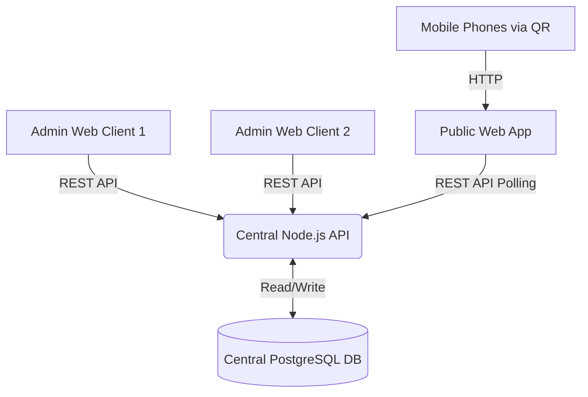

# SportX 🏆

**SportX** is a complete, centralized Sports Event Management, Live Score, and QR Access Platform. It has been built from the ground up prioritizing simplicity, stability, maintainability, and a professional user experience.

---

## 🏗️ Architecture

The system is designed with a **Central Source of Truth** architecture to support multiple administrators seamlessly without state desynchronization. The platform is entirely web-based.



### Components

1. **Central Database (`database/`)**: PostgreSQL database serving as the single source of truth for all events, teams, and live scores.
2. **Central API (`server/`)**: A Node.js/Express REST API written in TypeScript. It handles all business logic, QR code generation, and database interactions.
3. **Admin Dashboard (`web/admin.html`)**: A secure, protected web dashboard for authorized staff, allowing tournament control and score updates from any modern browser.
4. **Public Web Application (`web/`)**: A mobile-first, responsive HTML/JS/CSS frontend. Spectators scan QR codes and instantly view auto-updating live scores and brackets.

---

## 🚀 How to Launch Locally

### 1. Database Setup
1. Ensure you have **PostgreSQL** installed and running on port `5432`.
2. Create a database named `sportx`.
3. Run the schema and seed scripts against it:
   ```bash
   psql -U postgres -d sportx -f database/schema.sql
   psql -U postgres -d sportx -f database/seed.sql
   ```

### 2. Start the Central API
```bash
cd server
npm install
npm run dev
```
*The API will start on `http://localhost:5000`.*

### 3. Start the Web App
You can use any standard HTTP server to serve the static files.
```bash
cd web
npx http-server -p 3000
```
*The website will be available at `http://localhost:3000`.*

### 4. Admin Access
The admin dashboard is an integrated secure portal.
1. Navigate to `http://localhost:3000/login.html`
2. Login with the default credentials:
   - Username: `admin` (or `nirmit`)
   - Password: `admin123` (or `2019`)

---

## 📱 Core Features

- **Multi-Admin Synchronization**: Update a score on one admin device, and it is instantly reflected on all other devices and spectator phones.
- **QR Code System**: Generate printable QR posters dynamically via the backend API.
- **Zero-Friction Mobile Experience**: Scanning a match QR code routes directly to the specific live match page—no menus, no searching.
- **Automated Bracket Generation**: Admins can generate and visualize tournament brackets dynamically.
- **Live Auto-Polling**: The web client automatically polls the central API to update scores in real-time with subtle visual indicators.
- **Premium UI**: Dark sports aesthetics, high-contrast typography, and micro-animations designed for professional broadcast environments.